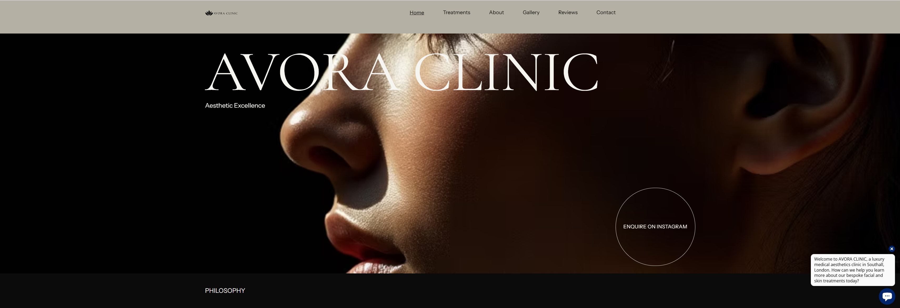
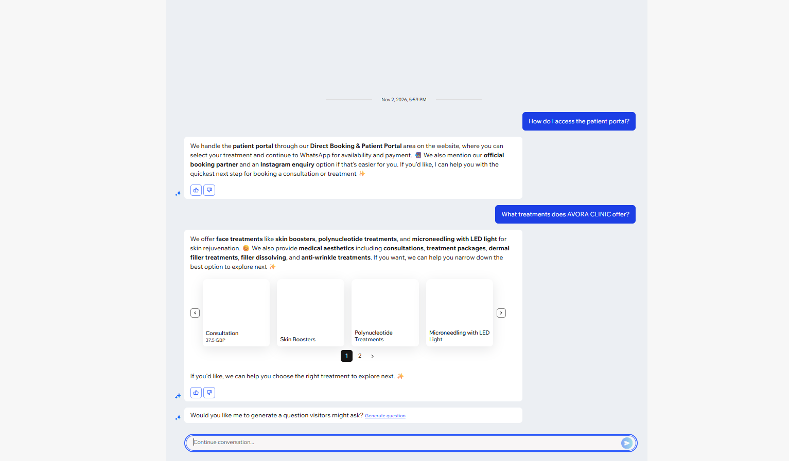

# AVORA CLINIC — Complete Website Project

## Live Website

🌐 **[Visit AVORA CLINIC](https://avoraclinic.wixsite.com/my-site-1)**

## Project Overview

AVORA CLINIC is an aesthetic clinic website designed and developed using Wix, with additional custom frontend development using HTML, CSS and JavaScript.

The project combines visual website design, treatment information, consultation enquiries and a custom-built treatment-booking interface.

## Main Website Features

- Branded clinic homepage
- Treatment categories and service information
- Clinic philosophy and aesthetic approach
- Consultation enquiry form
- Instagram enquiry integration
- Responsive website presentation
- Custom HTML, CSS and JavaScript treatment-booking interface

## Technologies and Platforms

- Wix Website Builder
- HTML5
- CSS3
- JavaScript
- Visual Studio Code
- AI-assisted development
- Docker and Microsoft Azure for the separate custom booking application

## Project Architecture

**Main Website:** Wix → AVORA CLINIC website → Treatment information and consultation enquiries

**Custom Booking Application:** HTML/CSS/JavaScript → Docker → Azure Container Registry → Azure Container Apps

The Wix website and the custom booking application are separate parts of the wider AVORA CLINIC project.

## Custom Development

The `index.html` file in this repository contains the custom treatment-booking interface developed separately from the Wix website.

The complete Wix website is available through the live website link above.

### Full Wix Website Preview

## Website Preview

## AI Chatbot Integration — Wix Smart Chat

AVORA CLINIC includes an AI-powered customer assistance chatbot configured using Wix Smart Chat.

### Features
- Answers visitor questions about available aesthetic treatments.
- Provides information about consultations and booking enquiries.
- Displays relevant treatment suggestions and service cards.
- Uses indexed website content to generate responses.
- Supports automated visitor assistance.

### Configuration and Testing
- Configured 7 AI guidance rules.
- Connected the chatbot to indexed website content.
- Customized the chatbot's communication style.
- Successfully tested treatment and booking questions in Wix's private testing environment.

### AI Chatbot Demonstration

**Platform:** Wix Smart Chat

