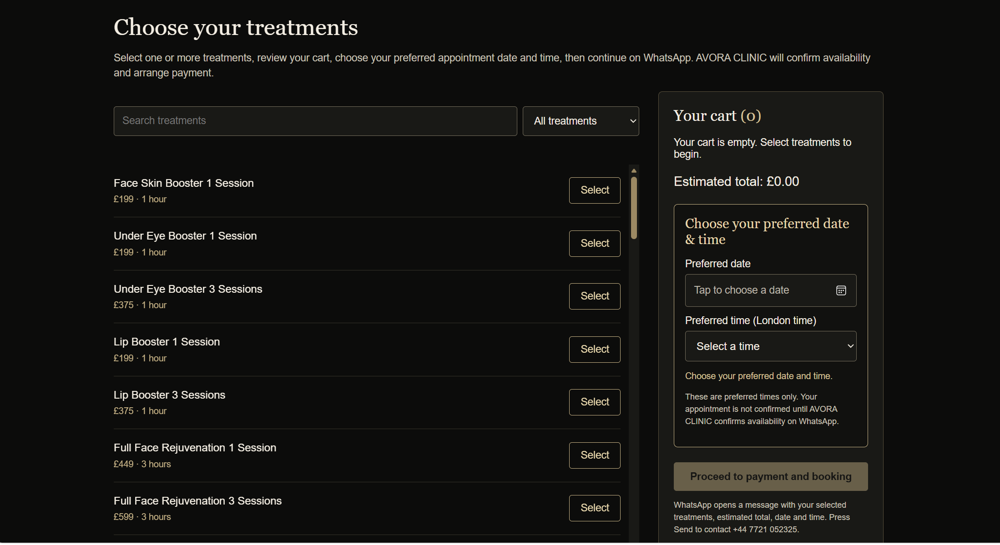

# AVORA CLINIC — Treatment Booking Website

## Project Overview

AVORA CLINIC is a responsive treatment-booking website developed using HTML, CSS and JavaScript.

The application allows visitors to explore clinic treatments, view pricing, select services, choose preferred appointment dates and times, and prepare booking enquiries through WhatsApp.

## Technologies Used

- HTML5
- CSS3
- JavaScript
- Visual Studio Code
- AI-assisted development

## Key Features

- Interactive treatment catalogue
- Treatment pricing and selection
- Booking cart
- Appointment date and time selection
- WhatsApp booking enquiries
- Responsive website interface

## How to Run the Project

1. Download the repository.
2. Open `index.html` in a web browser.
3. Explore the treatment catalogue and booking interface.

## Development Approach

The website was developed using AI-assisted coding and iterative testing to refine the interface and user experience.

## Cloud Deployment

The application was also containerized using Docker and successfully deployed to Microsoft Azure using Azure Container Registry and Azure Container Apps.

The Docker and Azure deployment workflow will be documented in a separate GitHub repository.

## Website Preview

